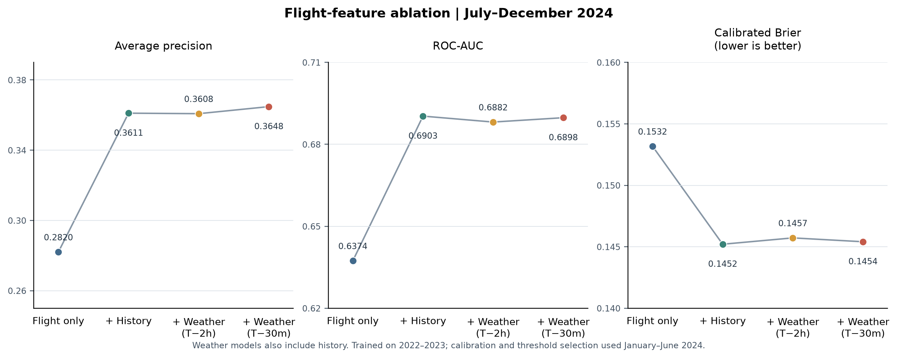

# Flight and weather feature plan

## Scope

This document covers Yash's flight/weather work: scheduled flight information, historical delay rates, observed weather, prediction horizons, and the combined model. Airport-state, aircraft-rotation, and network-propagation features belong to Omruthik's lane.

## Data choice

The historical source is NOAA's [Global Historical Climatology Network hourly dataset (GHCNh)](https://www.ncei.noaa.gov/products/global-historical-climatology-network-hourly), the current successor to the older Integrated Surface Database. We use the station-year Parquet export for stations mapped to the BTS airport codes. The [official GHCNh documentation](https://www.ncei.noaa.gov/oa/global-historical-climatology-network/hourly/doc/ghcnh_DOCUMENTATION.pdf) defines the report fields and source/report-type codes.

A one-station 2024 pilot found 13,180 hourly/synoptic records at Atlanta, including 8,782 FM15 METAR reports. Its Parquet file was about 1.18 MB and matched NOAA's PSV export for the inspected values. The airport-to-station map covers 375 airport codes representing 40,581,082 flight movements in the 2022-2024 development and validation data. The mapping uses ICAO matches where available and a nearest-station fallback capped at 25 km.

An archived NDFD GRIB2 sample was also inspected. One CONUS apparent-temperature bulletin was about 6.0 MB and held 20 forecast grids. Retrieving forecast vintages for every airport, horizon, and needed element would be substantially larger than the observed-weather pilot, so the first weather experiment uses lagged observations. This is an observed-weather experiment; it does not claim that current destination conditions are a forecast for arrival.

### Flight/weather data feasibility matrix

| Feature group | Source and timestamp | Historical coverage used | Horizon | Feasibility and leakage rule |
| --- | --- | --- | --- | --- |
| Scheduled flight | BTS TranStats schedule fields (`FlightDate`, airline, route, scheduled times, distance, elapsed time) | 2022-2023 train; 2024 validation | T−2h and T−30m | Available before scheduled departure; actual times, delay minutes, and post-outcome fields are excluded from predictors. |
| Delay target | BTS `DepDel15`, determined from actual departure performance | 2022-2023 train; 2024 calibration/evaluation | Label for both horizons | Positive means departure delay of at least 15 minutes. Used as the outcome, never as a same-flight predictor. |
| Historical delay state | Prior BTS `DepDel15` outcomes, grouped globally, by airline, origin, route, and origin/hour | Built for 2022-2024; live inference can read only local published archives | T−2h and T−30m | Three completed months and prior 7/30 calendar days only; daily windows exclude the target date. Live results report the newest archive date because BTS releases lag actual operations. |
| Observed weather | NOAA/NCEI GHCNh FM15 reports, timestamped in UTC | 2021 only for the Jan 2022 lookback edge; model features for 2022-2024 | T−2h and T−30m | Use the latest report whose observation time plus a 15-minute availability proxy is no later than the cutoff; values older than 180 minutes are missing. |
| Current observed weather | AviationWeather.gov decoded METAR API; observation time and receipt time | Current feed; API database includes the previous 30 days | T−2h and T−30m | Use only reports received/available by the schedule-specific cutoff. This is not a destination-arrival forecast. |
| Archived forecast weather | NOAA NDFD GRIB2 archive | One CONUS bulletin inspected; full vintage coverage not assembled | Not included in this prototype | Forecast-vintage and element retrieval across all stations/horizons are too large for this first experiment; do not substitute a forecast issued after the cutoff. |

The 2025 split was kept outside the weather feature build and model fit, but it was opened in an earlier baseline exploration. It is therefore not listed as an untouched evaluation period.

## Leakage-safe observation join

For each scheduled flight, calculate the T−2h and T−30m cutoff from the scheduled departure timestamp in the **origin airport's** local time zone, then convert it to UTC. Attach the latest FM15 report at both origin and destination whose conservative availability proxy is no later than that same UTC cutoff:

```text
report_available_at = NOAA observation timestamp + 15 minutes
selected report      = latest report_available_at <= prediction cutoff
stale report         = report age > 180 minutes (weather values become missing)
```

Features include temperature, dew point, wind speed/direction/gust, visibility, sea-level pressure, and rain, snow, fog/mist, and thunderstorm indicators. Numeric values outside broad physical bounds are set missing; field-level and endpoint-level missing indicators are retained. Wind direction is encoded cyclically for modeling. The raw weather features remain available in output Parquet for audit; the model uses only the `_fresh` fields.

GHCNh is a quality-controlled historical archive, not a record of when each original observation was first received by an airline. The 15-minute delay is a conservative point-in-time proxy, not a historical receipt timestamp. The training data therefore support an observed-weather backtest with a documented availability assumption, not a perfect replay of the live information feed. For current inference, use the latest report actually returned by the live feed and its retrieval time.

## Historical delay features

The flight-only feature set includes airline, origin, destination, scheduled times, weekday/month, distance, and elapsed time. Historical delay rates are built from BTS `DepDel15` labels:

- Three prior completed calendar months: global, airline, origin, and route rates.
- Prior 7 and 30 completed calendar days, excluding the target flight's entire calendar date: global, airline, origin, route, and origin-by-scheduled-departure-hour rates.
- Airline/origin/route/hour rates use a 50-flight prior weighted by the corresponding global rate for the same lookback window.

The daily features are deliberately date-level, so earlier flights on the same date do not leak outcomes into later flights. This weather-feature build and its model runs do not read 2025. A separate frozen-baseline exploration opened 2025 earlier, so it is no longer a blind final test and must not guide later model choices. Recent BTS outcomes may not be available quickly enough for a live service; that refresh delay must be considered when deploying the historical features.

## Evaluation and limitations

Develop and calibrate on 2022-2024 only. The training split is 2022-2023; 2024 January-June is used for calibration and threshold selection, and July-December is the chronological evaluation period. Compare schedule-only, schedule plus history, and schedule/history plus weather at both horizons using average precision, ROC-AUC, Brier score, calibration, and operating-point metrics.

The 2025 split was opened earlier for a frozen-baseline exploration before weather and horizon modeling. The weather work does not read 2025, but 2025 is no longer a fully blind test and must not guide feature or model choices. A later untouched period will be needed for a genuinely independent final estimate.

### Initial feature ablation on July-December 2024

All three models below use 2022-2023 for training. For the history and weather models, Platt calibration and the F1 operating threshold were fit on January-June 2024 only. Raw Brier is measured before calibration; calibrated Brier and precision/recall/F1 use the frozen calibrator and threshold on July-December.

| Flight feature set | Average precision | ROC-AUC | Raw Brier | Calibrated Brier | Selected threshold | Precision | Recall | F1 |
| --- | ---: | ---: | ---: | ---: | ---: | ---: | ---: | ---: |
| Schedule only | 0.2820 | 0.6374 | 0.2152 | — | — | — | — | — |
| Schedule + historical delay | 0.3611 | 0.6903 | 0.1962 | 0.1452 | 0.2173 | 0.3166 | 0.5833 | 0.4105 |
| Schedule + history + observed weather, T−2h | 0.3608 | 0.6882 | 0.1961 | 0.1457 | 0.2174 | 0.3300 | 0.5293 | 0.4065 |
| Schedule + history + observed weather, T−30m | 0.3648 | 0.6898 | 0.1959 | 0.1454 | 0.2182 | 0.3344 | 0.5185 | 0.4066 |

Historical delay features account for most of the lift over the schedule-only baseline. T−2h weather is effectively neutral on this evaluation period. T−30m weather raises average precision by 0.0037 over history alone, while ROC-AUC and F1 stay nearly unchanged and calibrated Brier changes by only 0.0002. This is a modest development result, not evidence that weather improves every decision metric. The full 2022-2024 weather build contains 20,290,541 flight rows per horizon, with about 99.5% mean coverage at each endpoint. Its as-of audit found zero joined reports after cutoff and zero negative report ages.



## Current-flight inference

`src/predict_current_flights.py` accepts a CSV of scheduled flights, rebuilds historical features from local BTS Parquet partitions, requests recent decoded METAR observations only for the airport ICAOs in that input, and scores both trained horizon models. It does not retrain the models. Required CSV columns are `FlightDate`, `Reporting_Airline`, `Origin`, `Dest`, `CRSDepTime`, `CRSArrTime`, `Distance`, and `CRSElapsedTime`.

The current operational-history folder is separate from `train`, `validation`, and `test`; it is read only to make inference features. As of October 10, 2026, TranStats reports July 2026 as the latest available on-time-performance month. This still leaves August and September outcomes unavailable for an October prediction, so the command records the archive age and the recent-window missingness rather than pretending those labels exist. See the [BTS TranStats latest-data page](https://transtats.bts.gov/DL_SelectFields.aspx?QO_fu146_anzr=&gnoyr_VQ=FGJ).

The [AviationWeather.gov Data API](https://aviationweather.gov/data/api/) provides decoded current METARs and its database covers the prior 30 days. The inference command uses a six-hour, airport-scoped query with a custom user agent and pauses between requests. It selects only reports available by the scheduled-departure cutoff, converts wind knots to m/s and visibility statute miles to km, then applies the same three-hour staleness rule. A current METAR is still an observation, not a TAF forecast for a future destination arrival.

The inference command has passed a protected, one-row smoke test using a schedule row from the 2022–2023 training partition. It loaded the saved horizon models, read only the training partition for historical features, and marked weather missing because the 2023 cutoffs predate the live METAR archive. This verifies the inference path only; it is not a live prediction or a generalization evaluation. No actual upcoming-flight schedule has been supplied. See [the smoke-test record](inference_smoke_2026-10-10.md).

`src/render_flight_weather_page.py` turns the prediction CSV into a self-contained flight/weather page with both horizon probabilities, calibration thresholds, METAR values and ages, recent airline/route history, and the newest BTS outcome date. The target is binary, so the page explicitly says expected delay minutes are not estimated. Its weather/history context is not a causal explanation of the score.

## Reproduction commands

```powershell
# Build expanded historical features into a new directory so existing outputs remain intact.
python src/build_historical_features.py --output-dir data/processed/depdel15/historical_expanded --threads 4

# Build the airport-to-NOAA station map from 2022-2024 movements.
python src/build_weather_station_map.py --overwrite

# Download mapped station-year Parquet files. 2021 is needed only for the January 2022 lookback boundary.
python src/download_ghcnh_weather.py --years 2021 2022 2023 2024 --workers 4

# Join point-in-time observed weather at both horizons.
python src/build_ghcnh_weather_features.py --historical-features-dir data/processed/depdel15/historical_expanded --weather-dir data/raw/ghcnh --allow-missing-weather

# Train one model per horizon. Use separate output directories.
python src/train_baseline.py --weather-features-dir data/processed/depdel15/weather/t_minus_2h --output-dir data/processed/depdel15/weather_models/t_minus_2h --epochs 3 --alpha 0.00001
python src/train_baseline.py --weather-features-dir data/processed/depdel15/weather/t_minus_30m --output-dir data/processed/depdel15/weather_models/t_minus_30m --epochs 3 --alpha 0.00001
python src/plot_flight_weather_ablation.py

# Refresh a separate operational-history partition with the latest released BTS months.
python src/download_bts_months.py --years 2026 --months 1 2 3 4 5 6 7
python src/prepare_bts_operational_history.py --year 2026 --months 1 2 3 4 5 6 7

# Score a schedule CSV with both current-weather horizon models.
python src/predict_current_flights.py --input-csv data/inputs/current_flights.csv --history-dir data/processed/depdel15/flights --model-t-minus-2h data/processed/depdel15/weather_models/t_minus_2h/weather_logistic_sgd.joblib --model-t-minus-30m data/processed/depdel15/weather_models/t_minus_30m/weather_logistic_sgd.joblib --output-csv data/processed/depdel15/current_predictions.csv

# Render the CSV predictions as a flight/weather page.
python src/render_flight_weather_page.py --input-csv data/processed/depdel15/current_predictions.csv --output-html data/processed/depdel15/current_flight_weather.html
```
